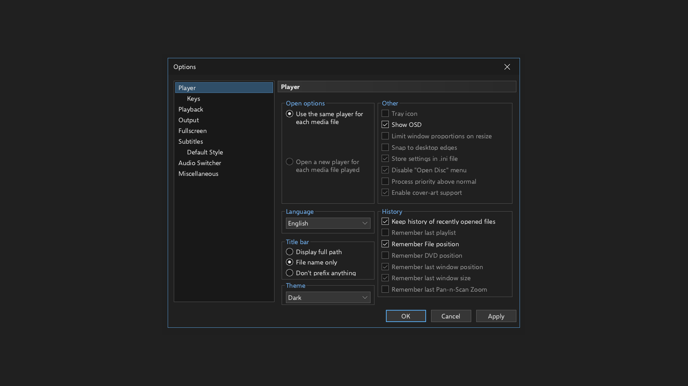

# Dark mode (1.6.1)

Open **View > Options > Player**, select **Theme > Dark**, and choose **Apply** or **OK**. Choose **Light** to
restore the original appearance. With a controller, use **L1/R1** to change controls, **D-pad Left/Right** to
change the theme, and **Cross** on Apply or OK. Cancel discards a selection that has not been applied.



The selection is stored as `DarkMode=1` (or `DarkMode=0`) in `/data/mpcps5/mpc-hc.ini` and loaded at startup.
Existing configuration files without this key use Light. Invalid values also use Light. Other preferences,
including subtitle colors, remain independent of the theme.

The theme changes the window caption, toolbar icons, menus, seek and volume controls, playlist, file browser,
Options pages, message boxes and common controls. Existing dialog labels resolve their default text color when
painted, so applying a theme updates dialogs that are already open. The toolbar cache includes the selected theme;
colored icons retain their colors and transparent pixels retain their alpha. Returning to Light restores the
original toolbar pixels. The video renderer, HDR processing and subtitle style are unchanged.

The version is `1.6.1`, with application content version `01.061.000` and the existing title ID
`PPSA99015`. See the [1.6.1 release notes](RELEASE-NOTES-v1.6.1.md) for downloads and updating.

## Validation

`make test-theme` runs the real Options dialog against isolated settings: Apply/OK/Cancel, restart persistence,
invalid values, text contrast, toolbar cache invalidation and alpha/color preservation. It writes screenshots of
all Options pages under `ps5/build/validation/theme/screenshots`.

`ONLY='1 2 9 17 36' WORK=<temporary-directory> bash tests/run-tests.sh` runs the original light interface,
playback/subtitles, Options and language regressions, plus the dark theme controller and playback checks.
The last group checks software and Vulkan rendering separately. Vulkan requires a working host Vulkan driver
(Lavapipe can be used for these functional tests).

For a checkout in a path containing spaces, dependencies can be built separately:

```sh
MPCPS5_DEPS_DIR=/path/without/spaces/mpc-deps bash tools/build-deps.sh host
make host test-theme DEPS_HOST=/path/without/spaces/mpc-deps/prefix-host
```

Host screenshots and functional tests do not replace a physical PS5 test. No console deployment is performed by
these tests.

## Observed results (November 10, 2026)

| Check | Result |
| --- | --- |
| Native PS5 GPU build, complete installer and embedded application | Passed; installer is 21,337,224 bytes |
| Application imports, runtime/link checks, RADV linkage and application profile | Passed |
| Linux host player, installer, helper and disc test build | Passed with Clang 18, ASan and UBSan |
| Theme harness | 41 checks passed, zero failed, including translated control widths and screenshots |
| Frontend groups 1, 2, 9, 17 and 36 | 60 checks passed, zero failed |
| Vulkan HDR output regression tests on Lavapipe | 15 checks passed |
| Original light palette comparison | All 46 original colors preserved |
| Translation table validation | 658 texts checked, zero problems |
| Release package through the real updater in an isolated host directory | 14 checks passed; six application files match the installer and ZIP byte for byte |

The first language regression run exposed four existing untranslated HDR/GPU labels. Translations were added in
Spanish, Brazilian Portuguese, French and German. The retry button and hint were checked against their actual
font metrics in all five languages; an overlong French label was shortened. The language group was rerun after
the wording adjustment. The English interface remains the default.

The build also exposed path handling failures in the dependency archive command and the runtime digest check.
The archive command now keeps object paths as separate arguments, the digest path is quoted, and
`MPCPS5_DEPS_DIR` allows a dependency cache outside a checkout containing spaces. A non-Linux-only alternate
stack size constant was moved into its matching conditional branch so Linux builds with Clang and `-Werror`
succeed. The console's crash handling behavior is unchanged.

Logs are stored locally under `ps5/build/validation/`, including `build-final.log`, `host-build-final.log`,
`make-test-theme.log`, `frontend-tests.log`, `languages-final.log` and `hdr-output.log`. The local installer is
`ps5/build/dist/MediaPlayerClassicPS5-v1.6.1.elf`; `SHA256SUMS` in that folder records its checksum.

The checks above cover this interface change and selected regressions. The full frontend suite was not run.
Physical PS5 validation remains pending.
