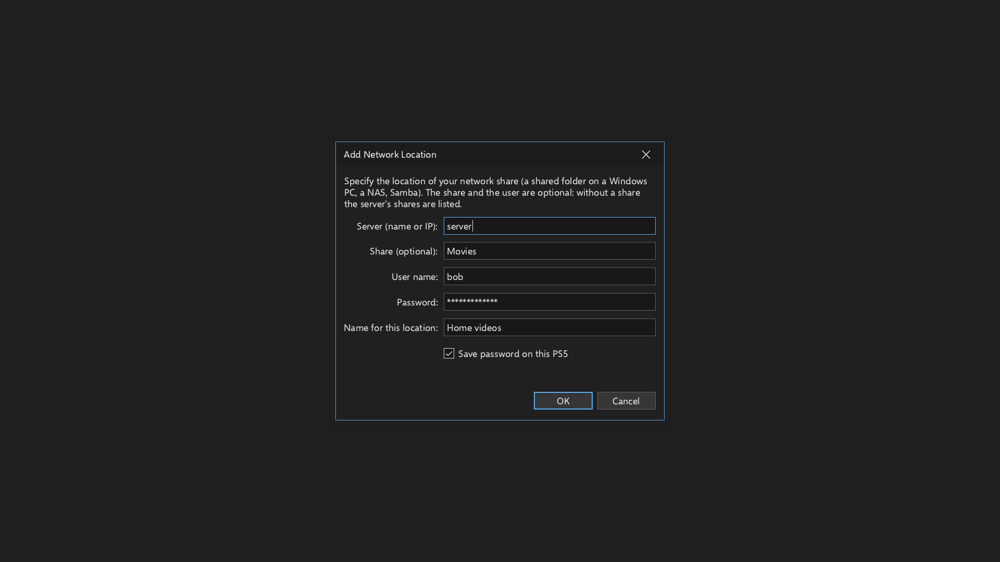

# Saved network passwords (1.6.2)

This change addresses [issue #7](https://github.com/MisterTemaki/MediaPlayerClassicPS5/issues/7): passwords
are hidden in the interface and saved encrypted instead of in plaintext. There is no master password,
unlock step or separate credential-management dialog.

## SMB connection

Open **Add a network location**, enter the server, share, user name and password, then choose **OK**.
The password field and its on-screen keyboard show masked characters. Address fields, saved locations,
recent files, favorites and logs omit or redact the password.

**Save password on this PS5** is checked by default, matching the previous behavior of remembering network
credentials. Leave it checked to reuse the password automatically after restarting the app. Uncheck it to
use the password only during the current app session. If that account was saved previously, unchecking it
also removes its saved password. The user name and location may remain saved without a password.
Passwords are also removed from persistent storage after their last saved address is removed from network
locations, recent files, favorites, positions and the last folder. This cleanup follows a successful settings
commit, so a failed settings write cannot discard passwords used by the old settings.

Passwords included explicitly in a typed network URL are also captured and saved encrypted before the URL
enters the application model. Tokens in query parameters or other application-specific authentication
formats are outside this change's scope.

## Storage

- `/data/mpcps5/credentials.enc` contains authenticated encrypted account/password records.
- `/data/mpcps5/.credentials-device/key.bin` contains a random 256-bit local encryption key, not a network password.
- `mpc-hc.ini` contains password-free addresses and the existing settings.

The implementation uses the existing, unchanged Monocypher 4.0.2 dependency for
[XChaCha20-Poly1305 authenticated encryption](https://monocypher.org/manual/aead). The key and each fresh
24-byte nonce come from the operating-system entropy backend already used by Mbed TLS. There is no
hard-coded key, password-derived key, Base64-only encoding or plaintext fallback.

The key directory uses mode `0700`; key and encrypted files are created with mode `0600`. Symlink keys,
non-private key permissions, invalid formats, modified ciphertext and wrong or missing keys are rejected.
An existing encrypted file is never overwritten by generating a replacement key after key loss.

Encrypted writes use a temporary file, file sync, authenticated read-back verification and atomic rename.
Key writes are also private, synced and verified before use. Sensitive buffers are wiped when no longer
needed; decrypted credentials necessarily exist in memory while the network transport uses them.

Automatic reuse requires keeping the key on the console. Someone with access to both the key and the
encrypted file can recover the passwords. These file permissions do not protect against another program
with equivalent filesystem access. Keeping the key separate prevents the encrypted file alone from exposing
the passwords; it is not hardware-bound storage.

## Upgrading older settings

Passwords from old inline URLs and `credentials.ini` / `credentials.ini.new` are migrated automatically.
The old generation marker selects the correct file after an interrupted save. Plaintext files are removed
only after the encrypted copy has been saved, decrypted again to verify it, and password-free settings
have been committed. A failed write or malformed legacy file preserves the original data for retry.
The app cannot promise secure erasure of old SSD blocks or backups.

Existing settings, dark-mode preferences, favorites, positions and media are retained. The application
version is `1.6.2`, content version `01.062.000`, with the existing title ID `PPSA99015`.

## Validation

`make test-credentials` checks encryption round trips, automatic reload, independent random keys,
session-only credentials, failed writes, missing/wrong/symlink keys, private permissions and corrupt data.
`make test-credentials-ui` exercises the real SMB form, masking, the save checkbox, automatic migration,
retry after failure, URL rendering and all five supported languages. Frontend group 19 checks authenticated
SMB playback across app processes and migration from old settings, alongside its existing playback regressions.

Permission checks require a filesystem with POSIX permissions. A Windows-mounted filesystem without Unix
metadata cannot provide private-key permissions, so encrypted saving intentionally refuses that storage.
Host tests simulate PS5 calls and do not replace validation on a physical PS5.

Validation results for this change:

| Checks | Passed |
| --- | ---: |
| Encryption, automatic reload, private keys, corruption, failed writes and password cleanup | 36 |
| Real SMB form, masking, save checkbox, migration, retry and translated layouts | 31 |
| Theme harness | 27 |
| Frontend groups 1, 2, 9, 17, 19 and 36 | 93 |
| Existing update, log redaction, installer, GPU startup, decoder memory and HDR harnesses | 83 |

The **270 checks passed without failures** in the final runs. Host runs used Clang 18 with AddressSanitizer
and UndefinedBehaviorSanitizer; the 673-entry translation table also passed validation. The native PS5 GPU
build and complete installer passed the import, runtime-link, syscall, RADV and application-profile checks.
The SMB test server now waits for readiness instead of relying on a fixed startup delay.
The full frontend suite was not rerun, and physical PS5 testing is still pending.
