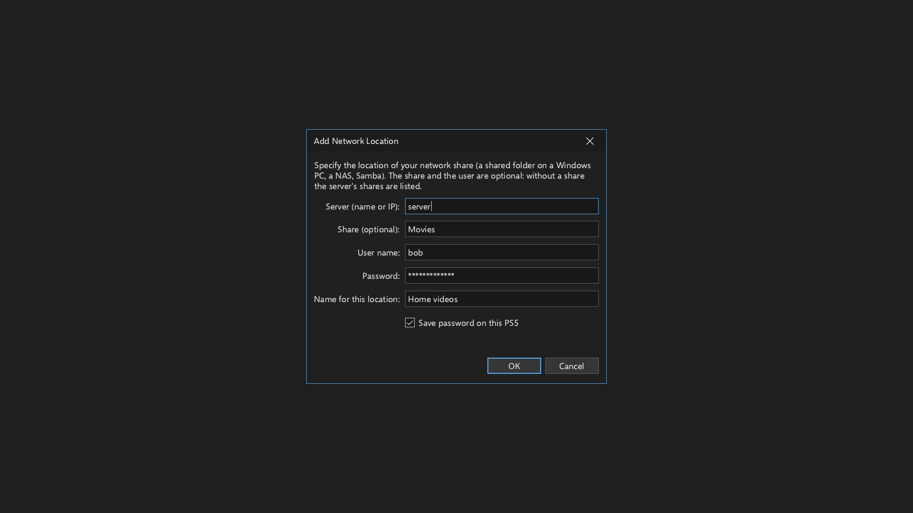

## Media Player Classic PS5 1.6.2

Encrypted network passwords and masked SMB credentials, addressing
[issue #7](https://github.com/MisterTemaki/MediaPlayerClassicPS5/issues/7).
Application version is **1.6.2**, content version is **01.062.000**, and the title ID remains **PPSA99015**.

### Changed

- Network passwords are saved with authenticated encryption instead of in the old plaintext credential file.
- Passwords are masked in the SMB form and its on-screen keyboard, and hidden from displayed and saved addresses.
- **Save password on this PS5** reuses the password automatically after restarting the app. Unchecking it keeps
  the password only for the current session and removes an earlier saved password for that account.
- There is no master password, vault screen or separate unlock step.
- Existing plaintext credentials migrate automatically after the encrypted copy is saved and verified.
  Failed writes or malformed legacy data preserve the original files for retry.
- Password cleanup still follows the last saved address: removing all references removes the persisted password
  after the settings commit succeeds.
- Dark mode, existing preferences, favorites, media and file positions are retained.

### Where to find the option

Open **View > Options > Miscellaneous > Network locations > Add...**. The **Save password on this PS5** checkbox
is below **Name for this location** and is checked by default. Fill in the location, choose **OK**, then apply
the Options changes. The file browser also offers **Add a network location...** in its navigation pane.

### Updating

- From 1.6.1 or an older version with the updater, choose **Help > Check for updates**, install the update and
  restart the app.
- For manual installation, use **MediaPlayerClassicPS5-v1.6.2.elf**, the complete installer, then open the app
  from the home screen. This is the only ELF asset for this release.
- If an older installer ELF is configured in autoload, replace that file with the new installer.
- Settings and media remain in `/data/mpcps5`; old plaintext credential files are removed only after verified
  migration and successful settings writes.

### Storage and protection

Passwords are encrypted with XChaCha20-Poly1305 using the existing Monocypher dependency. A random local key is
stored separately in an owner-only directory, with private key and credential files. Keys and nonces come
from the operating-system entropy source.

Automatic reuse requires storing the key on the console. Anyone who can read both the local key and encrypted
file can recover the passwords. This is not hardware-bound storage. See
[saved network passwords](https://github.com/MisterTemaki/MediaPlayerClassicPS5/blob/v1.6.2/docs/NETWORK-PASSWORDS.md)
for migration, session-only use and security limits.

### Files

- [MediaPlayerClassicPS5-v1.6.2.elf](https://github.com/MisterTemaki/MediaPlayerClassicPS5/releases/download/v1.6.2/MediaPlayerClassicPS5-v1.6.2.elf): complete installer.
- [MediaPlayerClassicPS5-v1.6.2-PPSA99015.zip](https://github.com/MisterTemaki/MediaPlayerClassicPS5/releases/download/v1.6.2/MediaPlayerClassicPS5-v1.6.2-PPSA99015.zip): application package for the in-app updater.
- [mpc-ps5-v1.6.2-src.zip](https://github.com/MisterTemaki/MediaPlayerClassicPS5/releases/download/v1.6.2/mpc-ps5-v1.6.2-src.zip): source code, tests, documentation and third-party notices.
- The matching `.sha256` files and `SHA256SUMS.txt` contain download checksums.

### Validation and limits

- **270 checks passed:** credential core 36, real SMB UI 31, theme harness 27, selected frontend groups
  1/2/9/17/19/36 93, and existing update/log/installer/GPU/decoder/HDR harnesses 83.
- Host runs used Clang 18 with ASan and UBSan. Authenticated SMB playback was checked across separate app
  processes, including automatic password reuse, session-only use and legacy migration.
- The 673-entry translation table passed validation in all five supported languages.
- The native PS5 GPU build and complete installer passed import, runtime-link, syscall, RADV linkage and
  application-profile checks.
- The installer and application update ZIP contain the same six application files. The manifest and stored
  ZIP entries were verified, and **14 package update checks passed** through the real updater in an isolated
  host directory, including checksum rejection and transaction cleanup.

The full frontend suite was not rerun. **This build has not been tested on a physical PS5.** Host tests use
simulated PS5 calls and software Vulkan; they do not confirm native console playback or HDR output.

Port by [MisterTemaki](https://github.com/MisterTemaki).
